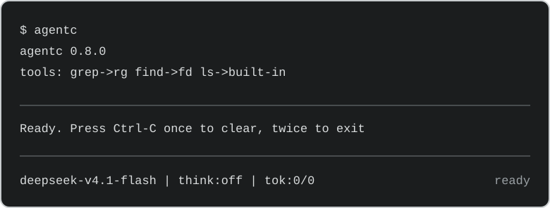

# agentc

A minimal, extensible coding agent in **freestanding C23** — zero libc, static
binaries, direct platform networking, vendored mbedTLS, and a versioned C ABI for C
and Rust extensions.

> **Related research:** the sibling project [opcode](https://github.com/abird-ai/opcode)
takes the same design to its extreme — a real coding agent written entirely in
hand-written x86-64 assembly, statically linked and libc-free. `agentc` is built off
the learnings from `opcode`: this is the production, supported sibling (`opcode`
points back here for real work).

- **~0.7 MB RSS at cold start**, **~2–4 MB** in a working session — roughly 0.7 MB plus
  2.5× the on-disk transcript
- Under 1 ms to launch; the 12 MB session budget holds up to ~4 MB transcripts
- **~940 KiB stripped** (~2.0 MiB with debug info) — 304× smaller on disk than codex, and
  ~285× less session memory than Claude Code
- **One tree → six targets:** Linux x86-64/aarch64/riscv64, macOS arm64/x86-64, Windows x86-64
- **MCP first** — tools, prompts, resources — then a versioned C ABI (`include/agentc_ext.h`)
- Benchmarked against [pi](https://github.com/earendil-works/pi) for UX and extensibility

`make bench` reports cold-start time, peak RSS and binary size for agentc on your machine;
[Footprint](#footprint) measures the same four numbers against codex, Claude Code and pi.

## Footprint

Four agents doing the same job, measured on one Linux x86-64 machine. Everything below is
observed, not estimated: peak RSS is `VmHWM`.

| agent | version | on-disk payload | cold start | cold-start RSS | first TUI paint | session RSS |
| --- | --- | ---: | ---: | ---: | ---: | ---: |
| **agentc** | 0.8.0 | **940 KiB** static binary, no runtime | **0.3 ms** | **0.7 MB** | **~1 ms** | **0.7 MB** |
| codex | 0.161.0 | 279 MiB native binary | 9 ms | 25 MB | ~20 ms | 85 MB |
| Claude Code | 2.1.293 | 241 MiB single-file binary | 9 ms | 39 MB | ~180 ms | 191 MB |
| pi | 0.99.2 | 17.5 MiB bundle + Node 24 (75 MiB) | 249 ms | 113 MB | ~800 ms | 209 MB |

- **Cold start** is `--version` (process start to exit, best of three) via `tools/measure.c`.
- **Session RSS** is the peak while the TUI sits at its prompt in a pty, sampled from
  `/proc/<pid>/status` every 50 ms; **first TUI paint** is the first byte it writes. Both
  include whatever the agent does before it paints.
- **Artifacts:** agentc is `make release`; codex and Claude Code are their vendor Linux
  x86-64 release tarballs — self-contained native executables at 279 MiB and 241 MiB; pi is
  its npm bundle plus the Node runtime it requires (Node is shared, not pi's own).
- The gap is the runtime, not the feature set. agentc ships no interpreter and no GC, so at
  the prompt it maps ~0.4 MB of its own text and holds ~0.2 MB of heap. The other three
  hold 85 MB (codex), 188 MB (Claude Code) and 139 MB (pi) of heap and shared memory —
  before a transcript exists.

## Quick start

```sh
# Linux / macOS
curl -fsSL https://raw.githubusercontent.com/abird-ai/agentc/master/install.sh | sh

# Windows (PowerShell)
irm https://raw.githubusercontent.com/abird-ai/agentc/master/install.ps1 | iex

agentc setup                      # pick a provider, store credentials, pick a model
agentc -p "summarise this repository"  # one-shot; drop -p to start the TUI
```



The installer verifies the release archive's SHA-256 and installs to `~/.local/bin`
(`AGENTC_INSTALL_DIR` overrides, `AGENTC_VERSION=0.8.0` pins).

## Build and test

```sh
make                      # -> build/agentc   (native: Linux x86-64, macOS)
make check                # offline golden suite + extension pipeline
make bench                # startup time, RSS, binary size
make install PREFIX=~/.local
make dist                 # release tarball + SHA256 -> dist/

make ext-pipeline         # C + Rust extension harness -> build/ext_harness
make client               # framed-protocol client -> build/agentc-client
make lib                  # embeddable SDK archive -> build/libagentc.a
make libcheck             # SDK archive + symbol deny-lists + PIE host link
make libstrict            # prove the SDK archive has no src/app/*.o
make install-lib PREFIX=~/.local   # SDK headers + libagentc.a/.so + agentc.pc
./tests/e2e.sh            # mock provider: tool round-trip, --continue, pty TUI
./tests/net.sh            # live loopback HTTP/SSE/TLS
./tests/mcp.sh            # MCP stdio against a python mock
sh tests/serve.sh         # agentc serve: unix/TCP/WebSocket/TLS, protocol, dialogs

make windows              # cross build -> build/agentc.exe (LLVM on PATH)
make wine-check           # run the Windows golden suite under Wine (Linux)
nix build                 # or nix develop
```

**Release matrix** — built by Nix on one Linux runner, attached to the tag:

```sh
nix build .#release-all
ls result-release/bin/
# agentc-linux-x86_64  agentc-linux-aarch64  agentc-linux-riscv64
# agentc-windows-x86_64  agentc-macos-arm64  agentc-macos-x86_64
# agentc-macos-universal
```

- Linux builds are freestanding on three architectures.
- Windows links no CRT/SDK; import libraries are generated from `src/win/*.def`.
- macOS slices carry the Apple SDK (fetched by Nix) and link libSystem through LLVM's
  Mach-O linker; `llvm-lipo` merges them into a universal binary.

To cross build by hand:

```sh
make release CC="clang --target=aarch64-unknown-linux-gnu" ARCH_FLAGS=-fno-pic \
     REL_OBJDIR=build/obj/aarch64/release OUT=build/agentc-aarch64
```

## Platforms

| target | builds | CI | driven by hand |
| --- | --- | --- | --- |
| Linux x86-64 | yes | golden, e2e, live net/TLS, MCP, extensions | yes |
| Linux aarch64 | yes | golden suite under `qemu-user` | yes |
| Linux riscv64 | yes | golden suite under `qemu-user` | yes |
| macOS arm64 | yes | golden suite, native Mac runner | no |
| macOS x86-64 | yes | same Mac runner | no |
| Windows x86-64 | yes | golden suite under Wine, real `cmd.exe` | no |
| Windows arm64 | yes (PE header checked) | native Wine on an ARM64 runner (non-gating) | no |

*Driven by hand* means a person ran a real session on that platform — not the same as a
suite passing in CI. Linux is exercised end to end, cross-built binaries included.

- **Windows CI covers:** the Win32 syscall surface, CRT-free startup, file/console/socket
  paths, the `WSAPoll` translation, and real `cmd.exe` execution (capture, redirection,
  exit codes, cancellation, background drain, truncation).
- **Still unverified:** Wine is not Windows — SChannel/TLS against a real provider, real
  console behaviour, PowerShell 5.1/`pwsh` execution and Windows ARM64 (Wine does not
  emulate a CPU) are untested. macOS and Windows produce valid Mach-O/PE images, but
  nobody has driven them by hand.

### Help wanted: macOS and Windows

- **macOS** — `make && make check` is enough; mention Apple silicon or Intel, since the
  two slices are built separately.
- **Windows** — `agentc --version`, `--list-models`, then a prompt that calls a tool.
  Most useful from a machine that only has Windows PowerShell 5.1.
- **TUI** — platform differences bite first at resize, unicode width, Ctrl-C and paste.
- **Reporting** — an issue with the binary you downloaded and your OS version.

Patches welcome: `src/plat/<os>` and `src/net/<os>` are the only directories a port touches.

**Toolchain:** `clang -std=c23 -ffreestanding -nostdlib -static` (no libc, own allocator,
own `_start`), GNU make, optional python3 for the extension registry. Freestanding targets
build with `-nostdinc` plus `third_party/freestanding/`, so a host libc header cannot leak
in through a vendored library.

**Shell on Windows:** `cmd.exe` by default. The `shell` config key selects `auto`, `cmd`,
`powershell` (7 if installed, otherwise 5.1) or `pwsh`; `AGENTC_SHELL` overrides the file,
and a missing requested shell is a clear error, never a silent fallback.

**Dynamic extensions:** CI builds and loads a real extension library on macOS/Windows
(`make dyn-check`), so runtime loading there is CI-gated rather than hand-tested.

## Providers, models and first-run setup

```sh
agentc setup [--offline]                  # provider, credentials, model
agentc --list-models [filter]             # catalog + discovered
agentc --refresh-models                   # ignore the 24 h discovery cache
agentc --provider ollama --model llama3.2
agentc --provider xai --model grok-4 --api-key $XAI_API_KEY
```

- **Built in:** `anthropic`, `openai`, `google` (native Gemini API), `ollama` (local, no
  key), `ollama-cloud`, plus the OpenAI-compatible presets `openrouter`, `xai`, `deepseek`,
  `groq`, `mistral`, `together`, `gemini` — one adapter, different base URL.
- **Discovery:** built-in catalog plus `GET /models` on the configured endpoint (Ollama's
  `/api/tags` first, so family and size show in the picker). Cached per provider for 24 h in
  `~/.config/abird/agentc/models-cache.jsonc`; `--offline` disables probes and a cache miss is
  never fatal.
- **First run:** a bare `agentc` on a tty with no credential, setup file or flags offers a
  short menu (local Ollama is probed for you), writing `setup.jsonc` and `auth.jsonc` (0600,
  merged so existing keys and OAuth logins survive).
- **Subscriptions:** `agentc login anthropic|openai` signs in with a subscription (OAuth) and
  makes that provider the default for the next start (it rewrites `setup.jsonc`, preserving
  any other keys you added); `--manual` prints the URL and reads the pasted code.
  `agentc logout [provider]` removes the stored credential — a subscription token or an
  `auth.jsonc` API key — for any provider id. If `config.jsonc` pins `default_provider`, login
  says so instead of silently writing an overridden `setup.jsonc`.
- **Precedence:** flags › `config.jsonc` › `setup.jsonc`; credentials `--api-key` › stored
  OAuth › provider env vars › `auth.jsonc` › config `api_keys`. A stored OAuth credential owns
  the provider, so a failed refresh is an error, never a fallback to an ambient key.
- **Custom gateways:** an unknown `providers.<id>.base_url` in `config.jsonc` becomes an
  OpenAI-compatible provider named `<id>`; it needs no credential (a local gateway may accept
  unauthenticated requests) and reads `api_keys.<id>`/`auth.jsonc` when one is set, so
  `--provider <id>`, `--list-models` and discovery work without a linked extension. For a
  one-off endpoint, `--base-url U` works alone (applied to the default provider) or with an
  unknown `--provider <id>` to define an ad-hoc gateway for that run; `agentc setup`'s **Custom
  endpoint** choice prompts for a name, base URL and optional key and persists it to
  `setup.jsonc`. Set `OLLAMA_HOST` or `providers.ollama.base_url` to point the Ollama preset at
  a non-default host.
- **Subcommands:** `setup`, `login` and `logout` are the only subcommands; `agentc update`,
  `agentc config` and `agentc mcp` are unimplemented and exit 2 (`unknown argument`). Edit
  `config.jsonc`/`mcp.jsonc` directly instead.
- **Virtual models (aliases):** a top-level `models.<alias>` config declares
  `{"provider":"…","model":"…"}`; the alias resolves to that concrete target per model step
  while the transcript keeps the alias, and a broken route fails the step closed. This is how
  to pin a cheap model for routine work or route around a provider without changing the
  session.
- **Extensions add providers too:** a linked extension registers its own wire dialect (request
  builder + SSE mapping) and model metadata via `add_provider`, while core keeps transport,
  retries, credentials and header sanitization (`extensions/fake_provider/` is the reference).

## MCP

- **Tools**, plus prompts and resources:
  - server `prompts` become `/mcp__<server>__<prompt>` commands (bounded synchronous `prompts/get`)
  - server `resources` go through three generic read-only tools: `mcp_list_resources`,
    `mcp_list_resource_templates`, `mcp_read_resource` (text only; `blob` entries are rejected)
- **Extensions** can add skill, prompt and theme roots via `resources_discover`, so prompts and
  named themes ship with the extension without an ABI change.
- **Limits** (over the cap the call fails rather than truncating): 512 prompt registrations,
  128 MCP prompts/server and 512 total, 256 resources/server and 1024 total, 64 KiB prompt text,
  256 KiB resource text, 64 file templates/themes per scan.
- **Resilience:** a failed server retries behind capped exponential backoff
  (`AGENTC_MCP_RETRY_MS=0` disables), status is published through `mcp_servers_change`, and an
  idle stdio server's `list_changed` is picked up on the next pump without a request. An idle
  HTTP server's optional GET event stream (`Accept: text/event-stream`, with `Mcp-Session-Id`
  and `Last-Event-ID`) is pumped the same way; `405` disables it for good and a dropped stream
  reconnects without failing the server.
- **Isolated extensions:** `agentc_ext_register_helper()` can run an extension in a separate
  process over the framed JSON hook protocol, so a crashing helper is retired fail-closed
  instead of taking the agent down (linked/dynamic extensions stay in-process).

## Interactive use

- `/model [id|alias]` and `/thinking [off|low|medium|high]` report or switch; with no argument
  each opens an interactive picker. A model id is provider-scoped: switching to a model that
  belongs to another provider is refused with a hint to restart with `--provider`, so the
  current endpoint is never silently pointed at a foreign model. A **virtual model (alias)**
  is the exception: `/model <alias>` and the picker — which lists aliases first, labelled
  `alias -> provider/model` — switch in place, because step routing resolves the concrete
  target; no restart is needed. Reasoning defaults to
  **medium** unless `--thinking` or `default_thinking` says otherwise. · `/resume` and
  `/continue` open a session picker at any point and switch cleanly (a running turn is
  cancelled first). · `/compact` summarizes the context. · `/help` ·
  `/theme [dark|light|<name>]` (named themes from `themes/<name>.jsonc`) · `/skill:<name>` ·
  any registered prompt template, including MCP `mcp__<server>__<prompt>`, runs as `/name` ·
  `/new` starts a fresh session · `/fork` branches the conversation into a new session ·
  `/tree` browses the session fork forest · `/clear` · `/quit`
- **TUI:** the interactive view is fullscreen (the alternate screen) with a transcript
  scrollbar and mouse-wheel scroll. On exit it leaves a compact trace in the shell
  scrollback — banner, the first prompt, `...`, the last message — instead of the whole
  transcript.

## RPC, `serve` and embedding

- **`agentc --mode rpc` (RPC v1)** is a language-independent control channel:
one JSON command per line on stdin, responses and events per line on stdout.
It is acceptance-first (`prompt` answers `{"disposition":"started"}` before
the run, which completes with an `agent_settled` event), queues commands while
a run is active, and exposes `get_state`/`get_commands`/`get_available_models`/
`get_messages`/`set_model`/`set_thinking_level`. The record layer is frozen in
`.agents/design/60-rpc.md`; the version is `AGENTC_RPC_VERSION` (1).
- **`agentc serve`** is a long-lived framed-CBOR session server. It listens on a
Unix socket by default (`$XDG_RUNTIME_DIR/abird/agentc/serve.sock`, `0600` in a
`0700` directory) or on TCP with `--tcp IP:PORT`, `--host IP[:PORT]` /
`--remote` (a non-loopback bind requires `--token`), `--ws` for an RFC 6455
WebSocket upgrade, and `--tls CERT KEY` for TLS (Linux, vendored mbedTLS). It
prints a ready JSON line, broadcasts agent events, and keeps a bounded registry
of up to **4 independent sessions** per process (serialized; each has its own
agent and transcript), with `new_session`/`attach`/`detach` routing a
connection between them. It raises `ui_request` dialogs
(`select`/`confirm`/`input`/`editor`) and tool approvals, and cancels a run out
of band. See `.agents/design/61-protocol.md`.
- **`agentc-client`** is the synchronous framed-protocol client (`make client`):
`prompt`, `events`, `call`, `state`, `cancel`, `reconnect`, `resync`,
`new-session`, `attach`, and a `ui` subcommand that answers a dialog.
- **`libagentc` (SDK)** embeds the engine in a host process (one engine / one
agent per process) through `include/agentc_sdk.h`. `make lib` builds the PIC
archive, `make libcheck` proves the symbol/object deny-lists and a default-PIE
host link, `make libstrict` proves the archive carries no `src/app/*.o`, and
`make install-lib PREFIX=…` installs the headers, static/shared library and
`agentc.pc`. See `.agents/design/70-sdk.md`.

## Decisions

- **Language:** freestanding C23; no assembly, no runtime.
- **TLS:** vendored freestanding mbedTLS 3.6.2 on Linux; the OS stacks elsewhere
  (SecureTransport, SChannel). The TLS path never `dlopen`s.
- **Ollama:** through its OpenAI-compatible `/v1` endpoint — one wire path for every
  OpenAI-style provider, no second SSE mapper.
- **Formats:** JSONC config/auth/themes, serde-default JSONL sessions; no cross-agent
  file-format compatibility.
- **Auth:** OAuth subscription logins (Claude Pro/Max, ChatGPT) ship in the initial release.
- **Extensibility:** MCP first, then a versioned C ABI whose tools may be synchronous or
  asynchronous. Extensions link into the binary, or on macOS/Windows load at runtime from
  `<config home>/extensions/` (the Linux freestanding build is static-only).
- **Parallel tool execution** on by default; **MIT** licensed.

## Related and thanks

`agentc` is built with heavy inspiration from [pi](https://github.com/earendil-works/pi) by
Mario Zechner, a minimal, extensible coding agent whose UX, extension model, tool set and
durable/MCP concepts shaped this design. pi is MIT licensed; no pi code or text is copied here.

- [opcode](https://github.com/abird-ai/opcode) — the sibling research project: the same
  agent written entirely in hand-written x86-64 assembly, built to push the design to an
  extreme. `agentc` is built off the learnings from `opcode`; the two share a feature
  surface, and `opcode` links back here as the production sibling.
- [Model Context Protocol](https://modelcontextprotocol.io) — the standard `agentc` speaks
- [Mbed TLS](https://github.com/Mbed-TLS/mbedtls) — the vendored TLS backend on Linux
- [curl CA extract](https://curl.se/ca/cacert.pem) — Mozilla CA trust anchors, replaced by a
  system bundle when one is present
- Built with [clang/LLVM](https://llvm.org), [Nix](https://nixos.org),
  [Rust/cargo](https://www.rust-lang.org) and GNU make

The architecture and design record live in [.agents/](.agents/) — [design/](.agents/design/)
for module contracts, [plans/](.agents/plans/) for forward-looking work. They are agent-facing
and are not part of the release artifacts.

## Contributing

We build agentc in the open and would love your ideas, architectural challenges,
research, and focused improvements. See [CONTRIBUTING.md](CONTRIBUTING.md) for the
best ways to take part.

## AI disclosure

**Human-centric design. AI-centric implementation.** agentc is built with
extensive AI assistance for research, code, tests, and documentation. We believe
the best software comes from human-led design and AI-assisted implementation:
humans own the architecture, priorities, and acceptance criteria, while AI helps
implement, test, and iterate. We don't hand direction to autonomous models or
claim every generated line is manually reviewed — correctness rests on explicit
designs, reproducible tests, and continuous validation.

## License

[MIT](LICENSE) © 2026 Prasanna Loganathar and contributors. agentc-authored text
and software are MIT-licensed. Vendored third-party components (mbedTLS, the curl
CA extract and the adapted base files) and other assets retain their respective
upstream licenses; see [THIRD_PARTY.md](THIRD_PARTY.md).
